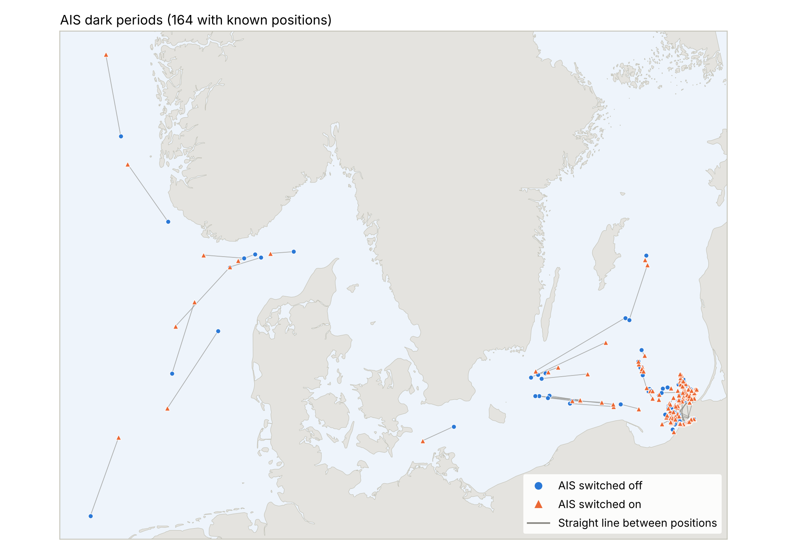
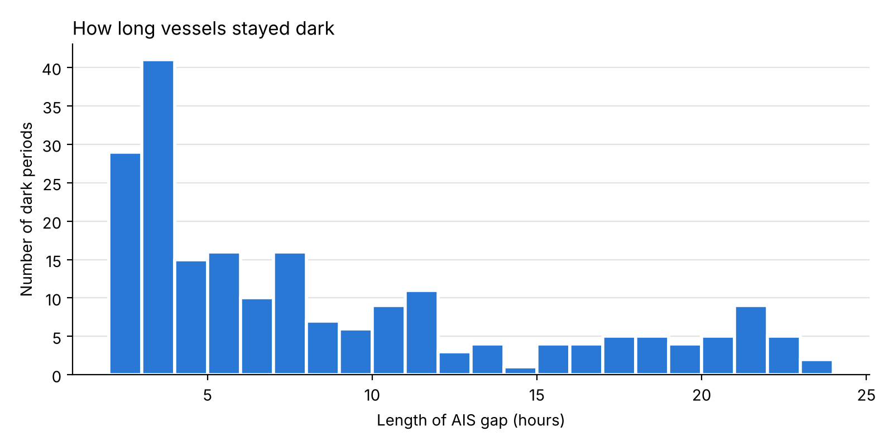

# Illegal Maritime Activity

[](https://github.com/CristinaB05/illegal-maritime-activity/actions/workflows/tests.yml)

Detecting when and where Russian fishing vessels switched off their AIS transponders in and around Danish waters in 2024.

Fishing vessels broadcast their position through AIS (Automatic Identification System). Turning it off for hours, a practice known as "going dark", can hide illegal fishing, smuggling or activity near undersea cables and offshore wind farms. This project finds those gaps in a year of Danish AIS data and maps where they happen.

It was developed as my group's contribution to a data sprint at the **University of Copenhagen** (February 2025). Results from the sprint were published in:

> Žugecová, A., Zhou, A., Faerch, C., Borini, C., Pedersen, J. S. R., Vladymyrova, M., Sherpa, N., Glage, N., Durstewitz, S. J., Cortese, S., Steensma, S., Sivertsgård, S., Tóth, T., & Golovchenko, Y. (2025). *Data Memo: Illicit Activities and Hybrid Threats at Sea*. SSRN. <https://papers.ssrn.com/sol3/papers.cfm?abstract_id=5315978>



## Method

A **dark period** is a gap between two consecutive AIS messages of the same vessel that is:

- **longer than 2 hours**, to ignore short technical drop-outs, and
- **shorter than 1 day**, to leave out docked vessels and vessels that left receiver coverage.

The last message before the gap marks where the AIS went **off**, the first one after it where it came back **on**. For each period the analysis records the time, both positions, the straight-line distance between them and the average speed that distance implies.

## Findings

| Russian fishing vessels, 2024 | |
|---|---|
| Vessels in the data | 83 |
| Vessels with at least one dark period | 48 |
| Dark periods | 211 (1,793 hours in total) |
| Median length | 6 hours |

- **A few vessels account for most of it.** 18 vessels went dark more than four times; the top five (MRTK-0770, MRTK-0777, VSESLAV, RUBIN, MPTK-0850) account for 75 of the 211 periods.
- **Most periods are in the south-eastern Baltic.** 150 of the 164 periods with known positions lie east of 17°E, towards Kaliningrad and the Lithuanian coast. A smaller group is in the North Sea and Skagerrak.
- **They cluster in time.** September alone has 113 dark periods, July 45.
- **Vessels mostly stayed close.** Half of the periods imply an average speed below 1 knot, consistent with fishing or drifting, but also with weak reception far from Danish receivers. 69 periods began while the vessel reported "Engaged in fishing".

These results flag vessels for closer inspection; they are not evidence of illegal activity on their own (see [Limitations](#limitations)).



## Repository structure

```
illegal-maritime-activity/
├── data/
│   ├── raw/              # raw AIS parquet file (not tracked, several GB)
│   ├── processed/        # Russian fishing-vessel subset used in the analysis
│   └── external/         # land outline; optional cable and Danish-waters layers
├── src/illegal_maritime_activity/
│   ├── preprocessing.py  # load AIS data, filter fishing vessels, MMSI -> flag
│   ├── gaps.py           # detect dark periods, label full tracks
│   └── plotting.py       # maps and charts
├── scripts/
│   ├── prepare_data.py   # raw parquet -> processed CSVs
│   ├── run_analysis.py   # dark periods -> results/ and figures/
│   └── make_maps.py      # cable map and monthly maps by flag
├── notebooks/
│   └── dark_periods_analysis.ipynb   # walkthrough with outputs
├── tests/                # unit tests (pytest)
├── results/              # generated tables
└── figures/              # generated figures
```

## Getting started

```bash
git clone https://github.com/CristinaB05/illegal-maritime-activity.git
cd illegal-maritime-activity
python -m venv .venv && source .venv/bin/activate
pip install -r requirements.txt

pytest                                  # run the tests
python scripts/run_analysis.py          # reproduce results/ and figures/
python scripts/run_analysis.py --min-gap 3 --max-gap 12   # try other thresholds
```

With the raw parquet file in `data/raw/`, the processed data and the sprint maps can be rebuilt for any flag group (`Russian`, `Danish`, or `FoC` for common flags of convenience):

```bash
python scripts/prepare_data.py data/raw/aisdk-2024-30m.parquet --flag Danish
python scripts/run_analysis.py --input data/processed/danish_fishing_vessels_2024.csv
python scripts/make_maps.py             # monthly maps of all fishing vessels by flag
```

### Outputs

| File | Content |
|---|---|
| `results/dark_periods.csv` | One row per dark period: vessel, off/on time and position, length, distance, implied speed |
| `results/dark_periods_per_vessel.csv` | Number of dark periods, total and longest dark time per vessel |
| `results/vessels_with_status.csv` | Every AIS message with `ais_off` / `ais_on` flags and a `Status` label |

## Data

AIS data for 2024 from the [Danish Maritime Authority](https://www.dma.dk/safety-at-sea/navigational-information/ais-data), resampled to one message every 30 minutes. The raw file is not included because of its size; the repository contains the Russian fishing-vessel subset (9,669 messages, 83 vessels) and the sprint's dark-period output. Flag states come from the first three digits of the MMSI number. Sources and columns are described in [`data/README.md`](data/README.md).

## Limitations

- **A gap is not proof of switching off.** It means no message reached a Danish receiver within the 30-minute window. Coverage weakens far from the coast, which partly explains the clustering in the eastern Baltic.
- **Some positions are missing.** 47 periods have an unavailable position at one end (latitude 91°); they are counted but have no distance and are not mapped.
- **The thresholds are a choice.** The 2 h / 24 h window comes from the sprint and can be changed on the command line.
- **Flag is not ownership.** The MMSI prefix gives the flag state, not who operates the vessel.

## Next steps

- Estimate the area each vessel could have reached while dark (last position, gap length, typical speed) and intersect it with submarine cables and offshore wind farms.
- Run the same analysis for Danish vessels and flags of convenience to see whether the pattern is specific to Russian vessels.

## Changes from the sprint code

The code was rewritten from the sprint notebooks into a tested package. The detection method is unchanged and reproduces the sprint result exactly. Fixes and improvements are listed in [`CHANGELOG.md`](CHANGELOG.md).

## Acknowledgements

Data sprint and data memo by a research group at the University of Copenhagen. AIS data from the Danish Maritime Authority. Land outline from [Natural Earth](https://www.naturalearthdata.com/).
